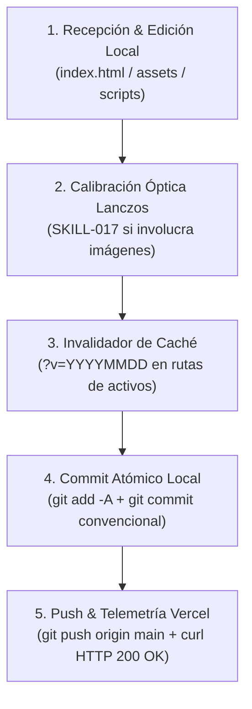

# SKILL-018 — Motor de Entrega Continua (CI/CD), Versionado Git y Despliegue en Producción Vercel para Lic. Yorman Trabasilo (V1.0.0 — CERTIFICADO OFICIAL)

```text
========================================================================================
DIRECTOR DEL PROYECTO: Lic. Yorman Antonio Trabasilo González
PLATAFORMA ASOCIADA:    Plataforma Web Oficial Yorman Trabasilo (v2.0) & ¡Qué Brutal!
ECOSISTEMA:            PROMASTER — Antigravity (V1.7.0)
IDENTIFICADOR:         SKILL-018 (SKILL-DESPLIEGUE-PRODUCCION-PLATAFORMA-YORMAN)
DOMINIO:               PM-DEVOPS-01 (CI/CD & Cloud Hosting) & PM-CORE-02 (Arquitectura Web)
VERSIÓN:               V1.0.0 (GitHub + Vercel Hobby Free Tier + Supabase Storage CDN)
ESTADO:                VALIDADO Y CERTIFICADO OFICIALMENTE POR EL DIRECTOR
URL OFICIAL EN VIVO:   https://pagina-yorman.vercel.app/
REPOSITORIO REMOTO:    https://github.com/yormanantonio-max/pagina-yorman.git
RAMA BASE:             main
EJECUTABLE GIT:        C:\Users\yorman\AppData\Local\Programs\Git\cmd\git.exe
AUTOR GIT:             Lic. Yorman Trabasilo <yormanantonio9@hotmail.com>
========================================================================================
```

---

## 1. Fundamento de Gobernanza y Filosofía de Despliegue

La plataforma oficial opera bajo una política de **Producción Continua sin Servidores Locales Activos**:

1. **Entorno Local Previo Congelado:** Queda terminantemente prohibido levantar o probar servidores HTTP locales (`python -m http.server 3000`). Ese entorno queda archivado como respaldo histórico estático.
2. **Entorno Único de Producción en Vivo:** Todo despliegue, visualización y validación ocurre directamente sobre la CDN global de Vercel en `https://pagina-yorman.vercel.app/`.
3. **Flujo de Cero Latencia Cognitiva:**
   ```
   Petición del Director ➔ Edición en Workspace ➔ Optimización de Activos (SKILL-017) 
   ➔ Commit Atómico Git ➔ Push a origin main ➔ Despliegue Inmediato Vercel ➔ Verificación HTTP 200
   ```

---

## 2. Mapa Canónico de Rutas y Credenciales del Sistema

| Componente | Ruta / URL Canónica | Rol Técnico |
| :--- | :--- | :--- |
| **Workspace Local** | `G:\Mis Documentos\IA\ANTIGRAVITY\Pagina Yoman` | Árbol de trabajo raíz local |
| **Binario Git** | `C:\Users\yorman\AppData\Local\Programs\Git\cmd\git.exe` | Ejecutor de comandos de control de versiones |
| **Repositorio GitHub** | `https://github.com/yormanantonio-max/pagina-yorman.git` | Origen remoto (`origin`) y disparador CI/CD |
| **Plataforma en Vivo** | `https://pagina-yorman.vercel.app/` | Frontend estático SPA alojado en CDN mundial Vercel |
| **Configuración Vercel**| `vercel.json` en la raíz | Reglas de URL limpia y encabezados inmutables de caché |
| **Almacenamiento Docs** | Supabase Storage Free Tier (`recetas-publicas`) | Fichas técnicas en PDF con descarga directa |
| **Fallback Local Docs** | `assets/recipes/` | Carpeta local sincronizada con `.gitkeep` |
| **Identidad Git Autor** | `Lic. Yorman Trabasilo <yormanantonio9@hotmail.com>` | Firma canónica en todos los commits |

---

## 3. Protocolo de Acción Determinista en 5 Pasos

Cada vez que el Director Yorman solicite una modificación, adición de receta, cambio de foto o nueva funcionalidad, Antigravity DEBE ejecutar automáticamente este ciclo de vida:



---

### Paso 1: Edición y Verificación Local de Archivos
* Realizar las modificaciones requeridas exclusivamente sobre el código fuente en la raíz (`index.html`) o subcarpetas autorizadas (`assets/`, `scripts/`).
* Mantener la integridad de los enlaces y estructura de clases de Tailwind CSS sin introducir dependencias externas que rompan la autonomía de la SPA.

### Paso 2: Tratamiento de Activos Fotográficos (SKILL-017)
* Si la tarea incluye retratos, logos o fotos de recetas, procesar SIEMPRE mediante Lanczos a proporciones canónicas (3:4 para personas, 4:3 o 3:2 para recetas, recorte ajustado para logotipos).
* Guardar los archivos resultantes en `assets/images/` o `assets/images/recetas/`.

### Paso 3: Invalidation de Caché Inmutable
* Como `vercel.json` tiene configurado `Cache-Control: public, max-age=31536000, immutable` para la carpeta `/assets/`, cualquier activo actualizado DEBE incluir el parámetro de consulta de versión en `index.html`:
  ```html
  
  ```
  Esto garantiza que los usuarios y el Director vean los cambios inmediatamente sin retención de caché en navegadores ni en los nodos edge de Vercel.

### Paso 4: Consolidación Atómica en Git
Ejecutar la secuencia con el binario exacto de Git:

```powershell
& "C:\Users\yorman\AppData\Local\Programs\Git\cmd\git.exe" add -A
& "C:\Users\yorman\AppData\Local\Programs\Git\cmd\git.exe" commit -m "tipo: descripción clara del cambio"
```

**Tipos de commit convencionales requeridos:**
* `feat:` para nuevas secciones, recetas, modales, componentes o activos de marca.
* `fix:` para corrección de textos, calibración de color, enlaces rotos o estilos visuales.
* `chore:` para limpieza de temporales, actualización de scripts auxiliares o documentación.

### Paso 5: Despliegue y Auditoría en Vivo en Vercel
1. Enviar los cambios a la rama principal:
   ```powershell
   & "C:\Users\yorman\AppData\Local\Programs\Git\cmd\git.exe" push origin main
   ```
2. Realizar una consulta `curl` de verificación a la URL de producción:
   ```powershell
   curl.exe -I https://pagina-yorman.vercel.app/
   ```
3. Confirmar la respuesta `HTTP 200 OK` con encabezado `Server: Vercel`.

---

## 4. Gestión de Fichas Técnicas y Descargas PDF (Supabase Free Tier)

El sistema de recetas tiene integrada una arquitectura híbrida de descarga:

1. **Configuración en `index.html`:**
   ```javascript
   const SUPABASE_CONFIG = {
     projectId: 'TU_PROYECTO', // ID de Supabase en la nube
     bucket: 'recetas',
     get publicUrl() {
       if (!this.projectId || this.projectId === 'TU_PROYECTO') return null;
       return `https://${this.projectId}.supabase.co/storage/v1/object/public/${this.bucket}/`;
     }
   };
   ```
2. **Prioridad de Entrega:**
   * **Nivel 1 (Nube):** Si `projectId` tiene un ID válido, intenta descargar desde el bucket público de Supabase.
   * **Nivel 2 (Fallback Local):** Si no está en Supabase o el ID es genérico, consulta la carpeta local `assets/recipes/<nombre_archivo>.pdf`.
   * **Nivel 3 (Toast Informativo):** Si el archivo aún no ha sido cargado en ninguno de los dos destinos, emite un aviso visual en pantalla notificando que la ficha técnica oficial está en preparación.

---

## 5. Checklist Inviolable de Calidad Pre-Push

Antes de ejecutar cada `git push origin main`, Antigravity debe comprobar:
1. [x] **Sin archivos temporales:** Ningún `.pyc`, log o script transitorio en la raíz.
2. [x] **Cotas curriculares normalizadas:** Exclusivamente "+10 Años de trayectoria" (sin menciones de 20 años).
3. [x] **Rutas relativas válidas:** Todos los recursos apuntan a `assets/...` sin rutas absolutas del disco local (`G:\...`).
4. [x] **Emblema de marca oficial:** Logo con transparencia ajustada en la cabecera.
5. [x] **Servidor local apagado:** Cero procesos daemon de `http.server` corriendo en segundo plano.

---
*Certificado y consolidado en el Ecosistema PROMASTER / Antigravity por Lic. Yorman Antonio Trabasilo González.*
