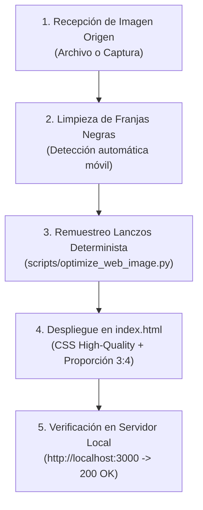

# SKILL-017 — Motor de Calibración de Resolución, Remuestreo Antialiasing Lanczos y Despliegue Fotográfico Web para Lic. Yorman Trabasilo (V1.0.0 — CERTIFICADO OFICIAL)

```text
========================================================================================
DIRECTOR DEL PROYECTO: Lic. Yorman Antonio Trabasilo González
PLATAFORMA ASOCIADA:    Plataforma Web Oficial Yorman Trabasilo (v2.0) & ¡Qué Brutal!
ECOSISTEMA:            PROMASTER — Antigravity (V1.7.0)
IDENTIFICADOR:         SKILL-017 (SKILL-OPTIMIZACION-IMAGENES-PLATAFORMA-YORMAN)
DOMINIO:               PM-WEB-01 (Arquitectura Frontend) & PM-MEDIA-02 (Fotografía Editorial)
VERSIÓN:               V1.0.0 (Resolución Calibrada 3:4 + Remuestreo Lanczos Antialiasing)
ESTADO:                VALIDADO Y CERTIFICADO OFICIALMENTE POR EL DIRECTOR
MOTOR AUTOMATIZADO:    scripts/optimize_web_image.py (en el workspace y en la skill)
RESOLUCIÓN HERO:       764 x 1024 px (Proporción 3:4 / Densidad Óptima 2x Retina)
========================================================================================
```

---

## 1. Diagnóstico Técnico y Fundamento Físico de Calidad

Cuando se integra una fotografía gastronómica o un retrato editorial en la web, existe un riesgo técnico crítico si no se calibra la resolución:

1. **El Fenómeno de Sub-pixel Aliasing (Sub-muestreo GPU en Chromium):**
   * Si se inserta una imagen masiva (ej. 1792×2400 px o 24 MP) dentro de un contenedor CSS de ~380 px, los samplers de textura de la GPU en navegadores omiten hasta el 85% de los píxeles intermedios.
   * Esto provoca que los brillos naturales de la piel, hebras de cabello y microtexturas se transformen en un **ruido blanco granulado y áspero**, dando la ilusión óptica de que la foto "está pixelada y fea".
2. **La Trampa de los Filtros de Convolución SVG:**
   * Queda **estrictamente prohibido** utilizar matrices convolucionales en CSS (`feConvolveMatrix`, `#sony-a1-optics`) o sobre-contrastes artificiales. En pantallas de alta densidad, estos filtros destruyen el degradado suave de la piel humana y del bordado textil.
3. **La Solución Determinista:**
   * Remuestrear la imagen a la **resolución exacta calibrada (764×1024 px)** utilizando el filtro matemático **Lanczos (`Image.Resampling.LANCZOS`)**. Este algoritmo aplica una función *sinc* con ventana de anti-aliasing que promedia perfectamente los píxeles, logrando una piel suave, tonos continuos, bordado nítido y cero grano digital.

---

## 2. Presets Canónicos de Resolución de la Plataforma

Toda imagen ingresada a la plataforma debe someterse a uno de los 5 presets estandarizados:

| Preset | Ancho × Alto (px) | Relación de Aspecto | Calidad JPG | Uso Exclusivo en la Plataforma |
| :--- | :--- | :--- | :--- | :--- |
| **`hero`** | **764 × 1024** | **3:4 (Vertical)** | **96%** | Retrato Principal Hero (Filipina Blanca, Fuego vivo, Horno y Mesa de Trabajo). |
| **`bio`** | **600 × 800** | **3:4 (Vertical)** | **95%** | Retrato Curricular y de Trayectoria Internacional (Sección 2). |
| **`recipe`** | **800 × 533** | **3:2 (Apaisado)** | **92%** | Tarjetas de Catálogo del Recetario y Platos Terminados. |
| **`modal`** | **1200 × 800** | **3:2 (Apaisado)** | **94%** | Visor Modal de Ficha Técnica Gastronómica Ampliada. |
| **`square`** | **600 × 600** | **1:1 (Cuadrado)** | **95%** | Iconografía de Talleres, Testimonios y Avatares de Alianzas. |

---

## 3. Protocolo de Acción Inviolable ante Nuevas Imágenes

Cada vez que el Director Yorman ordene: *"inserta / sube / cambia esta imagen en la página"*, el agente DEBE ejecutar automáticamente el siguiente flujo de 4 pasos sin saltarse ninguno:



### Paso 1: Localización e Ingesta de la Imagen
* Identificar el archivo fuente en el workspace, en la carpeta de descargas (`Downloads`) o en los archivos subidos por el usuario.
* Si el archivo contiene canal Alpha (RGBA PNG), convertir limpiamente a RGB sobre fondo neutro institucional (`#181818`).

### Paso 2: Ejecución del Motor Automatizado
Ejecutar el script oficial [`scripts/optimize_web_image.py`](file:///g:/Mis%20Documentos/IA/ANTIGRAVITY/Pagina%20Yoman/scripts/optimize_web_image.py):

```bash
# Para nuevo Retrato de Portada (Hero):
python scripts/optimize_web_image.py --input "ruta/a/imagen_origen.jpg" --output "assets/images/nombre_descriptivo.jpg" --type hero

# Para nuevo Retrato Curricular (Bio):
python scripts/optimize_web_image.py --input "ruta/a/imagen_origen.jpg" --output "assets/images/nombre_descriptivo.jpg" --type bio

# Para nueva Receta / Platillo:
python scripts/optimize_web_image.py --input "ruta/a/plato_origen.jpg" --output "assets/images/recetas/nombre_plato.jpg" --type recipe
```

### Paso 3: Integración Limpia en `index.html`
1. **Ruta local directa:** Apuntar el atributo `src` al archivo optimizado dentro de `assets/images/`.
2. **Estructura visual despejada (Regla de Cero Obstrucción):**
   * **Arriba:** Los botones selectores (`setHeroPhoto(n)`) deben ubicarse **fuera y arriba** de la foto (`mb-2.5 max-w-[400px]`), jamás flotando sobre la cabeza ni el arco del horno.
   * **Abajo:** La firma institucional debe ser un zócalo integrado en la base (`p-3.5 bg-brand-card/95 border-t border-brand-gold/30`), jamás una tarjeta flotante opaca que tape las manos, el corte de carne o la mesa de trabajo.
   * **Contenedor:** Mantener dimensiones calibradas (`max-w-[400px]`, altura equilibrada con la columna de texto adyacente `h-[490px]`).
3. **CSS Inviolable:**
   ```css
   .cinematic-portrait {
     image-rendering: high-quality;
     -webkit-backface-visibility: hidden;
     backface-visibility: hidden;
     transform: translateZ(0);
     transition: transform 0.5s ease;
   }
   ```

### Paso 4: Auditoría y Telemetría en Vivo
* Verificar que el servidor HTTP local en el puerto 3000 entregue la imagen con código `HTTP 200 OK`.
* Confirmar en consola que no existan errores 404 ni alertas de script.
* Notificar a Yorman para que refresque su navegador con `Ctrl + F5`.

---

## 4. Reglas Inviolables de Calidad Visual (Checklist de Aprobación)

1. [x] **Cero Ruido Granulado:** La piel del chef debe apreciarse suave, natural y continua; no deben existir puntos blancos ni sensación de arena.
2. [x] **Cero Bordes Negros:** Toda captura proveniente de dispositivos móviles debe tener sus barras negras superior e inferior recortadas automáticamente al 100%.
3. [x] **Proporción 3:4 Perfecta:** Ninguna imagen vertical debe verse estirada, aplastada ni desproporcionada.
4. [x] **Visibilidad de Atributos Identitarios:** El bordado de la filipina (*"Lic. Yorman Trabasilo / Maestro Culinario / ¡Qué Brutal!"*) y el resplandor del horno deben apreciarse con absoluta claridad sin ser tapados por elementos de la interfaz.

---
*Certificado e integrado en el Ecosistema PROMASTER / Antigravity por Lic. Yorman Antonio Trabasilo González.*
